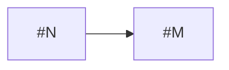

# Issue authoring — Milestone → EPIC → PBI (ADR-0004, ADR-0005)

Applies before any `gh issue create` / `gh api .../milestones` in this repository.

## 1. Order and hierarchy

File top-down, never bottom-up:

1. **Milestone** — a GitHub Milestone. One shippable state the user can name
   ("runs locally with feed and posting"). Its description uses the template in §4.
2. **EPIC** — an issue labelled `epic`, assigned to the milestone. One outcome a user can name.
   Holds goal, scope / out-of-scope, the dependency graph and the parallel lanes of its PBIs.
   No implementation tasks of its own.
3. **PBI** — an issue labelled `pbi`, assigned to the milestone and linked as a GitHub
   sub-issue of its EPIC. One vertical slice that delivers observable value, small enough for
   one `pbi-implementer` run (about one working day). Split by behavior, never by layer.

No loose issues: a PBI without an EPIC, or an EPIC without a milestone, is not filed.
Titles: `[EPIC] <outcome>` / `<what the user can do, or what stops happening>`.
An assumption nobody has run yet (a library, a tool, an image) becomes an investigation PBI
before anything is built on it.

## 2. DoR / AC / DoD are mandatory

Every milestone description, EPIC and PBI contains the three sections of §4, filled in.
An issue missing any of them, or with a placeholder left, is not filed.

- **AC** are observable and each names its 確認方法 (a command, a test name, or a concrete
  manual step). No "works correctly" / "is improved".
- A screen-observable AC names its E2E scenario.
- **DoR** is checked by the Director before dispatch (`.claude/rules/delivery.md`). A PBI
  whose DoR is not fully ticked is fixed (the issue body edited) before it is taken.

## 3. Dependencies and parallelism — decided at filing time

The point of filing is to let the Director run several PBIs at once. While writing the EPIC:

- **Touch set.** Every PBI lists the files / directories / modules it will create or change
  (`触るファイル`). Two PBIs whose touch sets overlap cannot run in parallel: either order them
  (`blocked by`), merge them, or extract the shared part into its own earlier PBI.
- **Foundations first, thin.** Shared pieces (schema, layout shell, design tokens, auth, test
  harness, compose services) are small PBIs in wave 1, so wave 2+ can fan out.
- **Hot spots.** Changes to shared infrastructure (`compose.yaml`, the shared DB schema
  entry point, CI, package manifest and lockfile) are serialized: at most one PBI per wave
  touches each. Each PBI adds its own migration file instead of editing a shared one.
- **Explicit edges.** Each PBI states `blocked by #N` / `blocks #N`. Also set GitHub's native
  relationships (sub-issue, blocked-by) when the API allows; the body text is the source of
  truth.
- **Lanes.** The EPIC body carries a mermaid dependency graph and a wave table (wave → PBIs that
  can run together). Cross-EPIC dependencies are allowed and written the same way.
- In task lists reference children by number only (`- [ ] #12`); GitHub expands the title.

## 4. Templates (headings are literal — copy them verbatim)

### Milestone description

```markdown
## 目的
<one paragraph: what is true when this milestone is done>

## 準備完了の定義（DoR）
- [ ] 目的と範囲・範囲外が書かれている
- [ ] EPIC が全て起票され、EPIC 間の依存関係が書かれている

## 受け入れ条件（AC）
- [ ] <observable end-state> — 確認方法: <command / scenario>

## 完了の定義（DoD）
- [ ] 全 EPIC が閉じている
- [ ] 受け入れ条件を `main` の最新 commit で確かめ、記録を docs に残した
```

### EPIC

```markdown
## 目的
<outcome the user can name, and why it is needed (the underlying problem in one sentence)>

## 範囲 / 範囲外
- 範囲: …
- 範囲外: …

## PBI
- [ ] #N

## 依存関係と並列レーン

| Wave | 並列に進める PBI | 前提 |
|---|---|---|
| 1 | #N | – |

## 準備完了の定義（DoR）
- [ ] 目的・範囲・範囲外が書かれている
- [ ] 子 PBI が全て起票され、各 PBI の DoR が満たされている
- [ ] 依存グラフと Wave 表があり、同じ Wave の PBI の触るファイルが重ならない

## 受け入れ条件（AC）
- [ ] <end-to-end behavior across the PBIs> — 確認方法: <E2E scenario>

## 完了の定義（DoD）
- [ ] 子 PBI が全て閉じている
- [ ] 実ブラウザ（Chrome）で総合試験を行い、結果が PASS だった
- [ ] 総合試験のレポートと画面の写真を `docs/test-reports/` に commit し、`main` に push した
- [ ] 関係する docs と ADR が更新されている
```

### PBI

```markdown
## 目的
<who can do what, and the underlying problem in one sentence>

## スコープ / 範囲外
- スコープ: …
- 範囲外: …

## 触るファイル
- `path/or/module` (新規 | 変更)

## 依存関係
- blocked by: #N | なし
- blocks: #M | なし
- 関連 ADR: ADR-NNNN

## 準備完了の定義（DoR）
- [ ] 目的が一文で書かれている
- [ ] 受け入れ条件が観測可能で、それぞれに確認方法がある
- [ ] 触るファイルが書かれ、同じ Wave の他の PBI と重ならない
- [ ] blocked by の issue が全て閉じている
- [ ] 関連する ADR が決まっている（未決の技術判断が残っていない）
- [ ] 1 回の pbi-implementer の実行（およそ 1 日）に収まる

## 受け入れ条件（AC）
- [ ] AC1: <observable behavior> — 確認方法: <test name / command / E2E scenario>

## 完了の定義（DoD）
- [ ] 各 AC を、先に落ちるテストを書いてから実装した（TDD の記録あり）
- [ ] code-reviewer と security-reviewer の両方が APPROVE を返した
- [ ] 画面で観測できる AC の全部に E2E があり、通った
- [ ] verify（全ての確認）が `main` への rebase 後に 0 で終わった
- [ ] 決定があれば ADR を同じ commit で足し、docs が OKF v0.3 として妥当
- [ ] `main` に入って push され、issue に commit・確認結果を書いて閉じた
```
