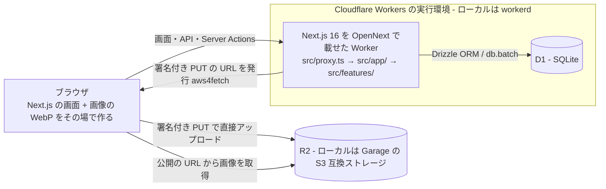

# システムの全体像と技術構成

決定は [ADR-0018](../adr/0018-nextjs-on-workers-via-opennext.md) から [ADR-0022](../adr/0022-testing-ui-and-package-management.md)、根拠は [調査](../research/stack-selection.md)。この文書は、その結果をコードの置き場所と名前に落とした「今の設計」で、PBI の実装方針はここを参照する。

## 全体の図

## ローカルと本番の対応

| 役割 | 本番（M2 以降） | ローカル（M1） |
|---|---|---|
| アプリの実行 | Cloudflare Workers | workerd（`opennextjs-cloudflare preview`。開発中は `next dev` が `getPlatformProxy` 経由で同じバインディングを使う） |
| DB | D1 | wrangler がファイルに持つ D1（`.wrangler/state`。worktree ごとに独立し、git には入れない）。compose に DB のサービスは無い |
| 画像のストレージ | R2（S3 API の署名付き URL） | compose の Garage `dxflrs/garage:v2.5.0`（S3 互換。スロットごとのバケット `insta-s<N>`） |
| シークレットと設定 | `wrangler secret` と `wrangler.jsonc` の `vars` | worktree の `.dev.vars`（git には入れない。#20 のスロットのスクリプトが作る。`.env.local` は使わない） |
| 結合テストの DB | – | `getPlatformProxy({ persist: false })` のメモリ上の D1 |

## 環境変数

`.dev.vars`（ローカル）か Workers のシークレット（本番）で渡す。コードは `getCloudflareContext().env`（スクリプトは `getPlatformProxy().env`）から読み、`process.env` に頼らない。

| 名前 | 内容 | 例 |
|---|---|---|
| `BETTER_AUTH_URL` | アプリの公開の URL（Better Auth の `baseURL`。`Origin` の検査に使う） | `http://localhost:3101` |
| `BETTER_AUTH_SECRET` | セッションの署名のシークレット（32 バイトの乱数） | 実行時に生成。コミットしない |
| `S3_ENDPOINT` | S3 互換のエンドポイント（R2 は `https://<account>.r2.cloudflarestorage.com`） | `http://localhost:3910` |
| `S3_BUCKET` | バケット名 | `insta-s1` |
| `S3_ACCESS_KEY` / `S3_SECRET_KEY` | 署名付き URL を作る認証情報 | 実行時に生成。コミットしない |
| `AUTH_PEPPER` | パスワードのハッシュに掛ける HMAC の鍵（32 バイトの乱数。シークレット）。ローカルの値は #20 のスロットのスクリプトが `.dev.vars` に生成し、コミットしない。ローテーションはハッシュの形式の版を足して行う（[ADR-0020](../adr/0020-better-auth-with-pbkdf2.md)） | 実行時に生成 |
| `S3_PUBLIC_BASE_URL` | 画像を配信する公開の URL（`storage_key` を足して使う） | `http://localhost:3910/insta-s1` |
| `PORT` | `dev` と `start` が使うポート（既定 3100、スロット N は `3100 + N`） | `3101` |

D1 は環境変数ではなく、`wrangler.jsonc` のバインディング `DB`（型は `cloudflare-env.d.ts`。`wrangler types --env-interface CloudflareEnv cloudflare-env.d.ts` で作る）。

## コマンド名

| コマンド | 実行するもの | 備考 |
|---|---|---|
| `dev` | `next dev --port ${PORT:-3100}` | `next.config.ts` が `initOpenNextCloudflareForDev()` を呼ぶ |
| `build` | `opennextjs-cloudflare build` | `open-next.config.ts` の `buildCommand: "pnpm exec next build"` が中で `next build` を呼ぶ（`build` が自分自身を呼ばないため） |
| `start` | `opennextjs-cloudflare preview --port ${PORT:-3100}` | `build` の後。workerd で動く |
| `typecheck` | `tsc --noEmit` | typescript は試作で動いた 5.9.3 に固定する（7 系は試していない） |
| `lint` | `eslint .` | ESLint 10、`eslint.config.mjs` |
| `format:check` | `prettier . --check` | |
| `test` | `vitest run` | 単体と結合 |
| `e2e` | `playwright test` | `webServer` が `start` をスロットのポートで起動する |

## ルートのファイルの場所

Next.js の App Router の規約に従い、`src/app/` に置く。ルートのファイルは薄く、`src/features/<slice>/` の部品を組み合わせるだけにする。固定のセグメントは `[username]` より先に一致するので、[routes.md](routes.md) の予約したユーザー名が使える。

| URL | ルートのファイル |
|---|---|
| `/` | `src/app/(app)/page.tsx` |
| `/accounts/signup` | `src/app/accounts/signup/page.tsx` |
| `/accounts/login` | `src/app/accounts/login/page.tsx` |
| `/accounts/edit` | `src/app/(app)/accounts/edit/page.tsx` |
| `/create` | `src/app/(app)/create/page.tsx` |
| `/p/[postId]` | `src/app/p/[postId]/page.tsx` |
| `/[username]` | `src/app/[username]/page.tsx` |
| `/[username]/followers` | `src/app/[username]/followers/page.tsx` |
| `/[username]/following` | `src/app/[username]/following/page.tsx` |

ログインが必要な画面は `src/app/(app)/`（ルートグループ。URL に出ない）の下に置く。その `layout.tsx` が未ログインを `/accounts/login` へ `redirect` する（[ADR-0031](../adr/0031-login-only-screens-in-app-route-group.md)）。

そのほかのファイル。

- ルートのレイアウトは `src/app/layout.tsx`。`/accounts/logout` は `src/app/accounts/logout/page.tsx`。
- 認証のハンドラーは `src/app/api/auth/[...all]/route.ts`。
- ミドルウェアは `src/proxy.ts`。
- 画面から呼ぶ書き込みの処理は、[routes.md](routes.md) の処理名のファイル `src/features/<slice>/api/<name>.ts` に `"use server"` を付けて置き、画面は Server Action として呼ぶ。一覧を GET で読む処理は `src/app/api/<名前>/route.ts` が処理を呼んで JSON を返す。

## ADR-0014 と矛盾しない

[ADR-0014](../adr/0014-code-in-feature-slices.md) は置き換えない。Next.js は `src/app/`（ルート）、`src/proxy.ts`、`public/` の場所だけを規約にし、`src/features/` と `src/shared/` のディレクトリには何も課さない。ルーティングのファイルを薄く保つという ADR-0014 の決定は、`src/app/` のページとルートハンドラーに当てはまる。`conventions.md` の slice の構成は変えない。

## 後続の PBI への確定表

行は `| #<番号> | <未確定だった項目> | <決定> |` の形。

| 番号 | 未確定だった項目 | 決定 |
|---|---|---|
| #19 | パッケージマネージャーと実行コマンド・設定ファイルの名前・`/` のルートのファイル | pnpm 12（`packageManager` に固定、`.node-version` は `26`）。コマンドは上の「コマンド名」の表。設定ファイルは `next.config.ts`・`open-next.config.ts`・`wrangler.jsonc`・`tsconfig.json`（`allowImportingTsExtensions: true`）・`postcss.config.mjs`・`eslint.config.mjs`・`.prettierrc`・`vitest.config.ts`・`playwright.config.ts`・`pnpm-workspace.yaml`（`allowBuilds`）。`/` のルートのファイルは `src/app/page.tsx` |
| #20 | DB の種類と compose のサービス | DB は D1（ローカルは `.wrangler/state` のファイル）で、compose に DB のサービスは置かない。compose のサービスは S3 互換ストレージの Garage（`dxflrs/garage:v2.5.0`、`s3_region = "auto"`）だけ。スロットのバケットは `insta-s<N>`。ホストの S3 のポートは 3910（3900 は別のプロジェクトのコンテナが使うため。[ADR-0023](../adr/0023-slots-with-garage-and-d1-files.md)）。スロットのスクリプトは `.dev.vars` を作り、`wrangler d1 migrations apply DB --local` を流し、リセットで `.wrangler/state` を消す |
| #22 | CI の準備と install のコマンド | `actions/setup-node` で Node.js 26、pnpm は `packageManager` の版。install は `pnpm install --frozen-lockfile`。E2E の前に `pnpm exec playwright install --with-deps chromium`。DB のサービスは要らず、Garage だけを起動する |
| #23 | DB の型の対応・マイグレーションの作り方とファイル名・トランザクションの方式 | 型の対応は [data-model.md](data-model.md) の「DB の型の対応」（`timestamp` は `INTEGER` のミリ秒、`boolean` は `INTEGER` の 0 と 1）。マイグレーションは手書きの `migrations/NNNN_<name>.sql` を `wrangler d1 migrations apply DB --local` で流し、Drizzle のスキーマ（`src/features/<slice>/db/schema.ts`）は手で合わせて結合テストで一致を確かめる。トランザクションは `db.batch([...])`（`db.transaction()` は D1 で `Failed query: begin` になる）。結合テストは `getPlatformProxy({ persist: false })` |
| #24 | CSS の方式・ルートのレイアウトのファイル | Tailwind CSS 4（`postcss.config.mjs` に `@tailwindcss/postcss`、`src/app/globals.css` に `@import "tailwindcss"`）と Radix UI Primitives。足りないときだけ CSS Modules。ルートのレイアウトは `src/app/layout.tsx`（`globals.css` を import） |
| #25 | ミドルウェアの入口・静的ファイルにヘッダーを付ける方法・インラインのスクリプトに nonce が要るか | ミドルウェアは `src/proxy.ts`（Node.js ランタイム。OpenNext では実験的で、ビルドが警告を出すが workerd で動いた）。静的ファイルは Worker を通らないので `public/_headers` に書く（Worker が返す応答には効かない）。インラインのスクリプトは Next.js の水和用が出るので、`'unsafe-inline'` を許さないなら nonce が要る。`proxy.ts` が nonce を作って `Content-Security-Policy` に入れると Next.js が自分のスクリプトに付ける。その画面は動的な描画（`await connection()`）が要り、CPU 時間が増える |
| #36 | TypeScript のスクリプトの実行方法・認証ライブラリでパスワードを登録する API | `node scripts/<name>.ts`（Node.js 26 が型を取り除いて実行する。相対の import に `.ts` の拡張子を付け、`@/` の別名は使えない）。バインディングは `wrangler` の `getPlatformProxy()` の `env`。パスワード付きのユーザーは `createAuth(env).api.signUpEmail({ body: { name, email, password } })`（`createAuth` は `src/features/auth/` の、`getCloudflareContext` を import しない関数） |
| #45 | `getFeed` の HTTP の入口 | `GET /api/feed?cursor=<カーソル>` を `src/app/api/feed/route.ts` に置き、`getFeed` を呼んで `Page<PostView>` を JSON で返す。`/` の最初のページは `src/app/(app)/page.tsx`（サーバーコンポーネント）が `getFeed` を直接呼ぶ |
| #26 | ログイン必須の画面の守り方・サインアップの書き込みと Cookie・認証のハンドラー | ルートグループ `(app)` のレイアウトで守る。`signUp` は `users`・`accounts`・`sessions` を 1 つの `db.batch` で書き、Cookie は Better Auth の署名の形式で作る（有効期間 30 日）。Better Auth の HTTP ハンドラーは #31 まで置かない（[ADR-0029](../adr/0029-signup-writes-rows-in-one-db-batch.md)、[ADR-0030](../adr/0030-better-auth-session-and-rate-limit-rules.md)、[ADR-0031](../adr/0031-login-only-screens-in-app-route-group.md)）。サーバーの処理は `src/features/auth/api/<name>.ts`（テストできる本体）と `actions.ts`（`"use server"` の薄い入口） |
